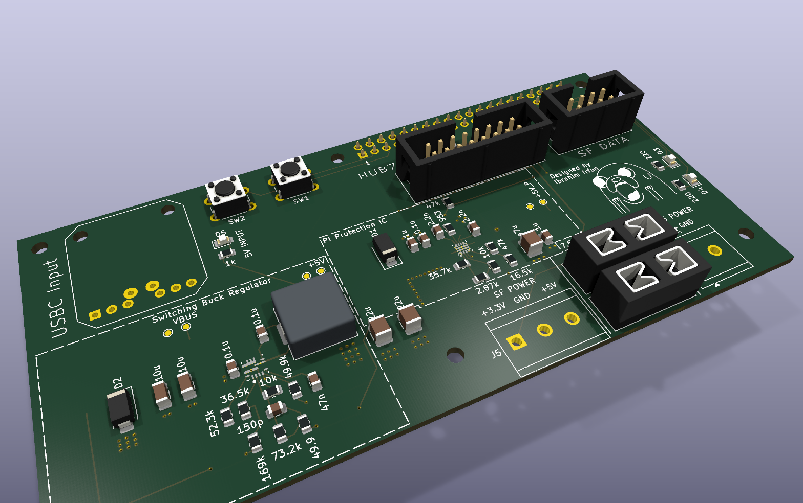
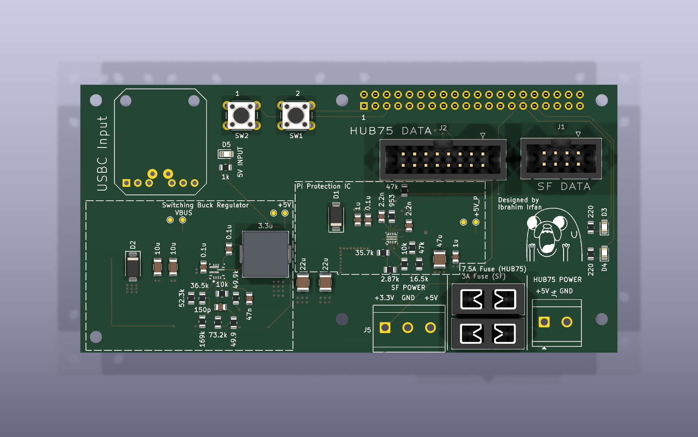
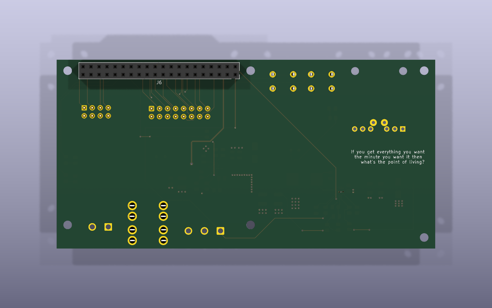
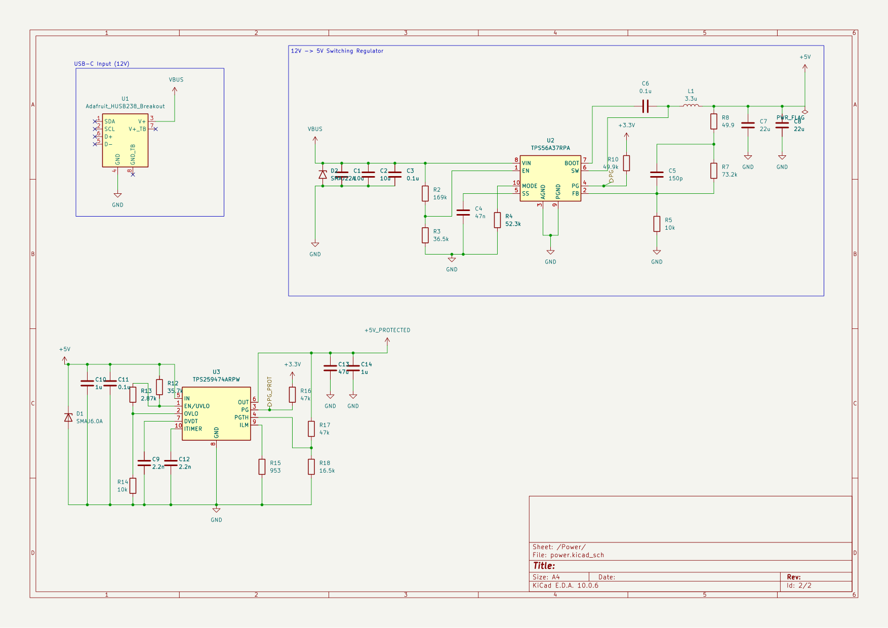
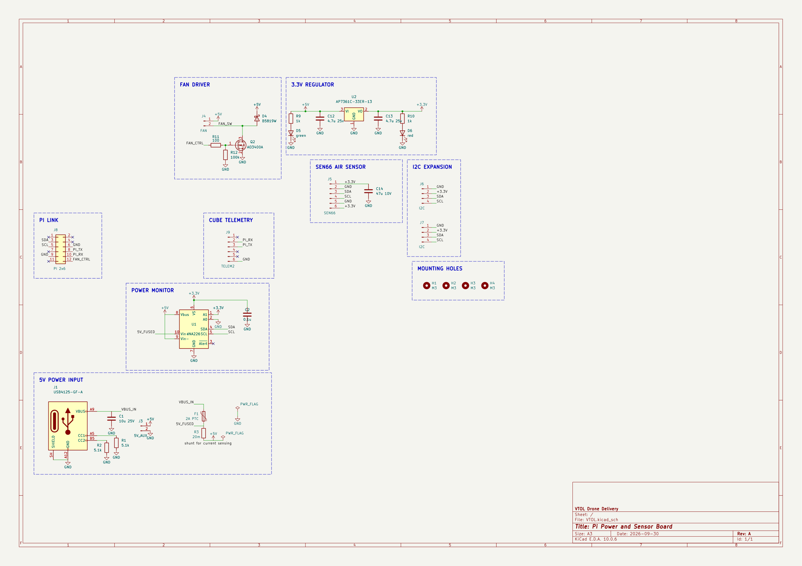
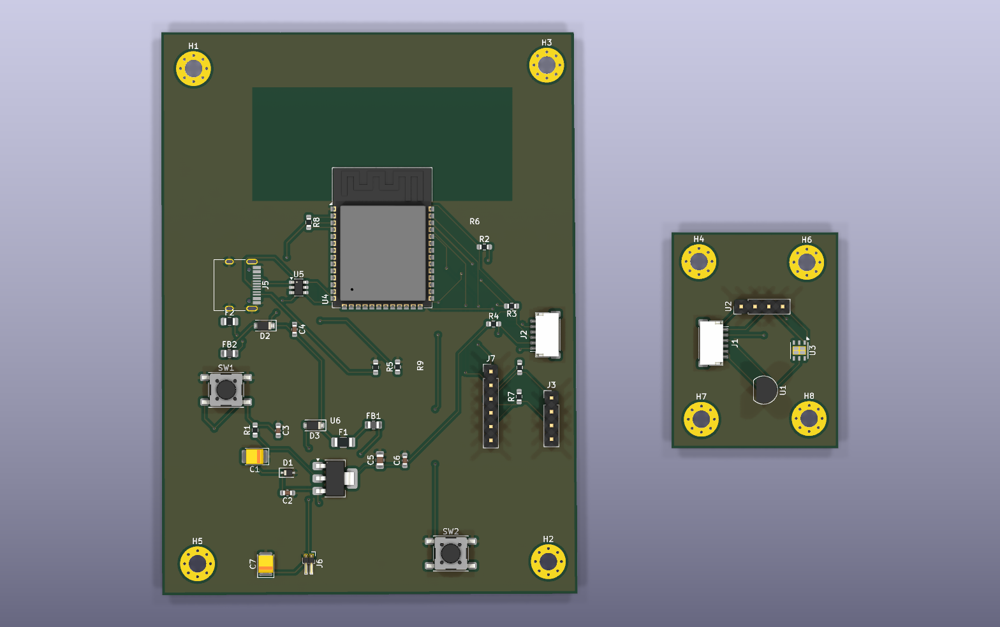
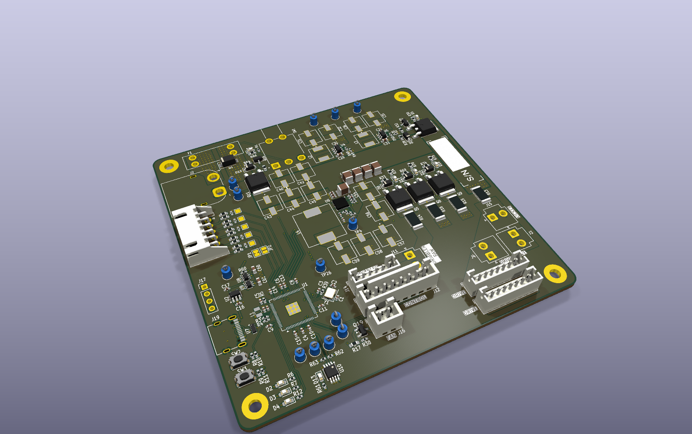
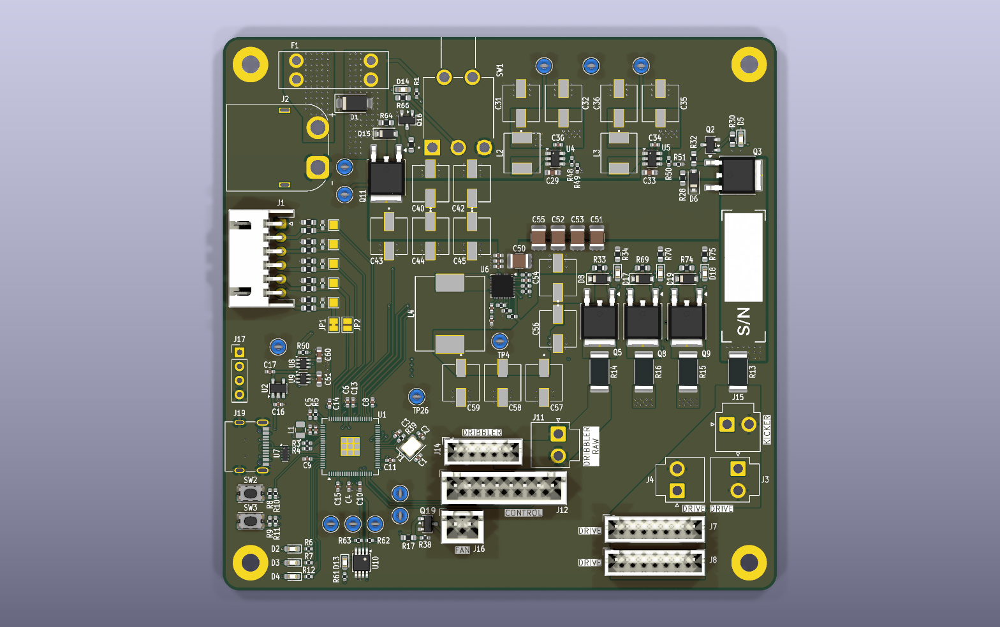

<h1 align="center">Hi, I'm Ibrahim 👋</h1>

  ECE student at <b>Georgia Tech</b> · PCB design · power electronics · embedded systems 
  Member of <a href="https://robojackets.org">RoboJackets</a> (RoboCup)

  
  
  
  
  
  

---

## 🔧 Projects

### 1. SplitFlap Display Control Board
**Repo:** [itsmeibii/SplitFlap-Control-Board](https://github.com/itsmeibii/SplitFlap-Control-Board)

A Raspberry Pi 4 controller board for a split-flap display with HUB75 LED matrix panels. It takes power from USB-C PD and runs the Pi, the split-flap motor drivers and the LED panels from one cable.

  

- **USB-C PD input:** HUSB238 trigger asks the charger for 20 V / 3 A (60 W)
- **TPS56A37 buck converter:** 20 V down to 5 V at up to ~8 A, with the buck held off by an EN/UVLO divider until PD has negotiated
- **TPS259474 eFuse on the Pi rail:** 5.83 V overvoltage cutoff, 3.5 A current limit, power-good fed to a GPIO
- **Separate fused outputs:** 7.5 A for the LED panels and 3 A for the split-flap modules, plus SMAJ TVS diodes on VBUS and 5 V
- 2-layer board with JLCPCB gerbers, a DigiKey BOM and a 3D-printed enclosure modeled in CadQuery

<b>Schematics, PCB layout and enclosure</b>

 

| PCB top | PCB bottom |
|:---:|:---:|
|  |  |

**Power schematic** (USB-C PD, buck regulator, Pi eFuse)

**Top-level schematic** (Pi header, HUB75, split-flap bus)

**Enclosure** (CadQuery → STEP for Fusion 360)

📄 [Full schematic (PDF)](assets/splitflap/SplitFlap-schematic.pdf)

---

### 2. VTOL Drone Delivery: Pi Power & Sensor Board
**Repo:** [itsmeibii/VTOL](https://github.com/itsmeibii/VTOL)

The power and sensor board for a VTOL delivery drone's companion computer. It powers a Raspberry Pi 4, reads environmental sensors over I2C, and links the Pi to the flight controller.

  

- **Power:** USB-C 5 V input, 2 A PTC fuse, AP7361C 3.3 V LDO
- **Power monitoring:** INA226 with a 20 mΩ shunt so the Pi can track current and voltage
- **Sensors:** Sensirion SEN66 air-quality sensor, plus two I2C expansion headers
- **Flight controller link:** UART to the Cube's TELEM2 port
- **Cooling:** low-side MOSFET fan driver controlled by a Pi GPIO
- Started out as an ESP32-S3 board (v1 layout below) and was later redesigned to run everything off the Pi

<b>v1 PCB layout (ESP32-S3 version)</b>

 

📄 [Full schematic (PDF)](assets/vtol/VTOL-schematic.pdf)

---

### 3. RoboCup Robot Power Board (RoboJackets)
**Repo:** [RoboJackets/robocup-pcb](https://github.com/RoboJackets/robocup-pcb/tree/feature/powerboard-bailout/boards/develop-2027/power-board/power-board-proto)

A 4-layer power distribution board for RoboJackets' RoboCup Small Size League robots. It has an RP2354B MCU and a 21 V battery bus feeding the motors, the kicker and the logic rails. The base board was designed by a teammate. **My work focused on the high-current power path:**

  

- **Motor rail hot-swap / inrush control:** replaced a P-FET load switch that would dissipate about 6 W at 20 A with a TPS2491 hot-swap controller and a 2.1 mΩ NTTFS2D1N04HL N-FET. Sized the 2 mΩ sense resistor, the power limit and the dv/dt ramp to charge about 1 mF of motor-driver capacitance safely.
- **Master switch:** checked candidate parts against the 21 V / 20 A requirement and moved to the BTS7002 smart high-side switch
- **Layout review:** found stale copper zones that were causing 172 DRC clearance errors, and checked the buck regulator layout against the datasheet

<b>PCB top view</b>

 

---

<i>All renders are generated straight from the KiCad design files.</i>

